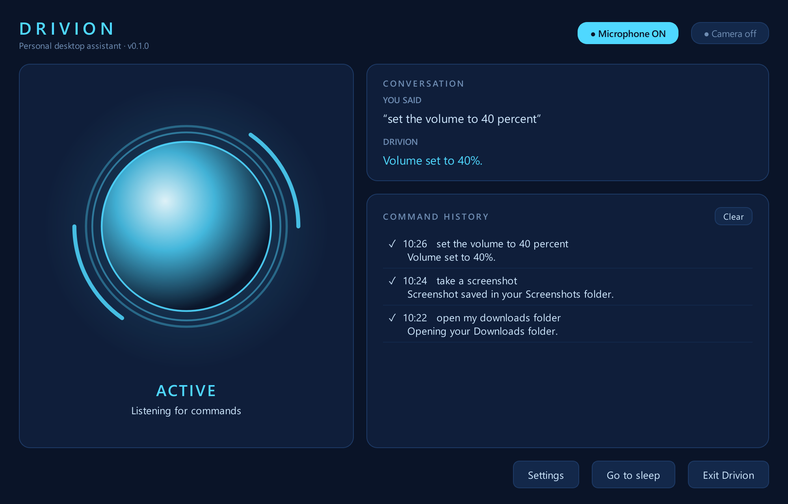
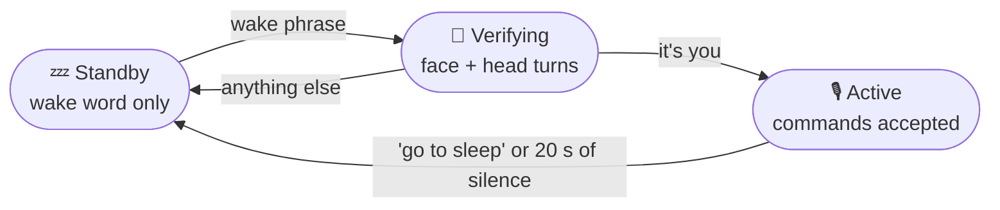

<div align="center">



<br>

**Say the wake phrase. Show your face. Tell your PC what to do.**

[](#-install)
[](#from-source)
[](#-built-with)
[](LICENSE)

[Features](#-features) •
[How it works](#-how-it-works) •
[Install](#-install) •
[Commands](#-what-you-can-say) •
[Privacy](#-privacy-and-safety) •
[Troubleshooting](#-troubleshooting) •
[Docs](#-documentation)

<br>



<sub>The real dashboard, with sample commands.</sub>

</div>

## ✨ Features

|   |   |
|---|---|
| 🎙️ **Hands-free wake phrase** | Runs quietly in the system tray and listens for "Hey Drivion" on your own PC |
| 🙂 **Face unlock** | Checks your face, then asks for random head turns before it accepts a command |
| 🗣️ **Offline voice commands** | Speech recognition and simple commands run on your computer, with no internet needed |
| 🖥️ **Control of your PC** | Opens any Start menu app, closes and arranges windows, types by voice, and switches Bluetooth, Wi-Fi and dark mode |
| 🛡️ **Safety layer** | Only registered actions run, and power actions need a spoken "yes" |
| 🤖 **AI fallback** | Questions go to Gemini, Groq or OpenRouter, and the next provider takes over if one fails |
| 🔒 **Local, encrypted face data** | Stores encrypted face templates rather than photos, tied to your Windows account |
| 🩺 **Built-in recovery** | `--doctor` finds problems and prints the fix, and `--self-test` proves every engine works |

## 🧭 How it works



1. **Standby.** No window is open, and only the small wake-word model is listening.
2. **Verifying.** The microphone is released and the camera turns on. Drivion matches your
   face, then speaks each step: turn your head, look back at the camera, and turn again.
   If anything is wrong, it says why, denies access and returns to standby. This is called
   *failing closed*.
3. **Active.** The camera turns off, the dashboard opens, and Drivion says *"I'm listening."*
4. **Back to standby.** Say *"Drivion, go to sleep"*, stay silent for 20 seconds, or close
   the window. Drivion keeps running in the tray.

> [!NOTE]
> The wake phrase is **"Hey Drivion"**. Speech is recognised on your computer, and nothing
> heard in standby is saved or logged. See [docs/WAKE_WORD.md](docs/WAKE_WORD.md).

## 🚀 Install

You can run Drivion in two ways:

- **Packaged build:** to use it. You need Windows 10/11 and about 1 GB of disk space, but
  not Python. Make the build with the [steps below](#-build-the-windows-package), then copy
  the `dist\Drivion` folder to the computer.
- **From source:** to change the code.

### Packaged build

1. Copy the `Drivion` folder somewhere permanent, such as `C:\Apps\Drivion`. Keep every file
   together, because the programs need the `_internal` folder beside them.
2. Open PowerShell in that folder, then run:

   ```powershell
   .\drivion.exe --download-models
   .\drivion.exe --enroll-face
   .\drivion.exe --self-test        # proves every engine works on this computer
   ```

3. Double-click **DrivionApp.exe**. A tray icon appears, and no window opens until you wake
   Drivion.

The two programs share everything in `_internal`:

| Program | Use it for |
|---|---|
| `DrivionApp.exe` | Everyday use, with no console window. Start at login uses this one |
| `drivion.exe` | Every command in this guide, because it can print to PowerShell |

Type `.\drivion.exe` wherever this guide says `drivion`, unless you add the folder to your
PATH.

> [!WARNING]
> The build isn't code-signed, so Windows SmartScreen may warn you the first time. Choose
> *More info → Run anyway* only for a build you made or trust.

### From source

You need Windows 10/11 and Python **3.11**. Check with `py -0p`, and install it from
python.org if `3.11` isn't listed.

```powershell
git clone https://github.com/dinithrathnayaka23/Drivion.git
cd Drivion
py -3.11 -m venv .venv
.\.venv\Scripts\Activate.ps1          # your prompt now starts with (.venv)
python -m pip install --upgrade pip
pip install -e ".[dev]"
drivion --download-models
drivion --enroll-face
drivion
```

If `Activate.ps1` is blocked, run this once:
`Set-ExecutionPolicy -Scope CurrentUser RemoteSigned`.

`-e` installs Drivion in *editable* mode, so your code changes take effect without
reinstalling.

### Model downloads

Models aren't included in the build or in Git. Download them once per computer:

```powershell
drivion --download-models
```

| Model | Size | How it's checked |
|---|---|---|
| Speech recognition (`base.en`), also used for the wake phrase | about 150 MB | Pinned revision |
| Optional openWakeWord engine | about 3.6 MB | Pinned SHA-256 hash for each file |
| Face (YuNet and SFace) | about 40 MB | Pinned SHA-256 hash for each file |

They go to `%LOCALAPPDATA%\Drivion\models` and work offline afterwards. A different
`voice.stt_model` needs this command again.

### Enroll your face

```powershell
drivion --enroll-face
drivion --test-face        # optional: live match score vs the threshold
```

The window asks for your consent first, and stores encrypted templates rather than photos.
See [docs/FACE.md](docs/FACE.md).

## 💬 What you can say

You don't need these exact words. Filler such as "please" and "can you" is ignored.

| Do this | Say something like |
|---|---|
| **Any installed app** | *"open Spotify"*, *"launch Photoshop"*, *"open task manager"* |
| **Websites and folders** | *"go to YouTube"*, *"open my downloads folder"* |
| **Windows Settings** | *"open settings"*, *"open bluetooth settings"*, *"go to wi-fi settings"*, *"open windows update"* |
| **Parts of Windows** | *"open the start menu"*, *"open search"*, *"show the desktop"*, *"open notifications"*, *"open quick settings"*, *"open task view"* |
| **Manage windows** | *"minimize Chrome"*, *"bring back VS Code"* |
| **Volume** | *"set the volume to 40 percent"*, *"louder"*, *"mute"* |
| **Brightness** | *"brightness to half"*, *"dim the screen"* |
| **Screen** | *"take a screenshot"*, *"lock the computer"* |
| **Power** ⚠️ | *"put my computer to sleep"*, *"restart the computer"*, *"shut down the computer"* |
| **Ask anything** 🌐 | *"who wrote Hamlet?"*, *"tell me a joke"* |
| **Windows and apps** | *"close Spotify"*, *"minimize this"*, *"switch to Chrome"*, *"snap this left"* |
| **Typing** | *"type hello team"*, *"press enter"*, *"save this"*, *"copy"*, *"undo"* |
| **Browsing** | *"new tab"*, *"close this tab"*, *"go back"*, *"scroll down"*, *"zoom in"* |
| **Quick switches** | *"turn off bluetooth"*, *"turn on wi-fi"*, *"turn on dark mode"*, *"pause"*, *"next song"* |
| **Drivion itself** | *"help"*, *"repeat that"*, *"cancel"*, *"stay awake"*, *"Drivion, go to sleep"* |

⚠️ Asks *"Are you sure…?"* and acts only on a clear **yes**. Saying "cancel" stops a restart
or shutdown during its 10-second delay.

🌐 Needs internet and at least one AI key.

Apps come from your Start menu, without uninstallers, repair tools or admin shortcuts. If a
name fits several apps, Drivion asks which one. Websites and folders must be in your
allowlist. See [docs/COMMANDS.md](docs/COMMANDS.md) and [docs/ACTIONS.md](docs/ACTIONS.md).

> [!TIP]
> **"Drivion, go to sleep"** only returns Drivion to standby. **"Put my computer to sleep"**
> sleeps Windows, after you confirm.

## 🖥️ Using Drivion

Drivion starts in standby, so no window opens. Look for a round icon under the `^` arrow on
the taskbar. Its colour shows the state:

| Icon | State | Meaning |
|---|---|---|
| 🔵 Blue | Standby | Listening for the wake phrase |
| 🟡 Amber | Verifying | Camera on, checking your face |
| 🩵 Cyan | Active | Dashboard open, accepting commands |
| 🔴 Red | Error | Something failed. Check the message, then choose *Recover from error* |

- **Open without the wake phrase:** choose *Open Drivion* in the tray. Your face is still
  checked.
- **Settings:** use the dashboard button or tray menu while unlocked. Changes apply the next
  time Drivion starts.
- **Standby:** choose *Go to sleep*, or close the window with X. Drivion keeps running in the
  tray.
- **Stop completely:** choose *Exit Drivion* in the tray or window, or press Ctrl+C in the
  terminal.
- **Launching it twice:** the second launch asks the running copy to open, then exits with
  code 3.

### Command reference

| Command | What it does |
|---|---|
| `drivion` | Start in standby (`python -m drivion` does the same) |
| `drivion --doctor` | Check everything and show how to fix any problem |
| `drivion --self-test` | Run every model and library on silence and a blank picture |
| `drivion --test-wake` | Listen for 30 seconds and show what Drivion hears |
| `drivion --check-config` | Validate the settings and show which keys are detected |
| `drivion --download-models` | Download and verify all models |
| `drivion --enroll-face` | Enroll your face |
| `drivion --test-face` | Show live match scores against your enrolled face |
| `drivion --test-liveness` | Try the head-turn check with a preview |
| `drivion --delete-face` | Delete all stored face data |
| `drivion --autostart on\|off\|status` | Control start at login |
| `drivion --list-audio-devices` | List microphones |
| `drivion --list-voices` | List Windows voices |
| `drivion --simulate` | Add a developer tray menu that fakes wake and face events |

With `--simulate`, choose *Wake word detected*, then *Face verified*, to reach the dashboard.
*Voice command* then sends harmless sample phrases through the real pipeline, so you can try
commands without a microphone. These are real actions: *"Take a screenshot"* really saves
one to `Pictures\Screenshots`. The samples never include power commands.

## ⚙️ Configuration

Every setting is optional. Most people only need the settings screen. To edit the files
directly from a source install, start from the examples:

```powershell
Copy-Item config\settings.example.toml config\settings.toml
Copy-Item .env.example .env
```

| File | Contains | In Git? | In a packaged build |
|---|---|---|---|
| `config/settings.toml` | Your settings | No | `%LOCALAPPDATA%\Drivion\config\settings.toml` |
| `.env` | Your API keys | No | `%LOCALAPPDATA%\Drivion\.env` |
| `config/settings.example.toml` | Documented defaults | Yes | `settings.example.toml` in the program folder |
| `.env.example` | Secret placeholders | Yes | `.env.example` in the program folder |

Invalid values, such as `sensitivity = 1.5`, and unknown keys stop Drivion at startup with a
message that names the bad setting.

### AI keys (optional)

In `.env`, or in *Settings → AI provider*, set any of these. One is enough, and with several,
Drivion falls back between them.

```ini
DRIVION_GEMINI_API_KEY=your-key
DRIVION_GROQ_API_KEY=your-key
DRIVION_OPENROUTER_API_KEY=your-key
```

Keys only ever go in `.env`, never in `settings.toml` or the code. `drivion --check-config`
shows which ones are detected without printing them. See [docs/AI.md](docs/AI.md).

### Start at login

This is off by default. Turn it on with *Settings → Privacy → Start Drivion when I sign in to
Windows*, or:

```powershell
drivion --autostart on       # also: off, status
```

Drivion then starts in standby when you sign in, and **listens for the wake phrase from then
on**, with its tray icon showing. It doesn't unlock anything, because your face is still
checked when you wake it. The setting applies to your Windows account only and needs no
administrator rights. You can also turn it off in *Task Manager → Startup apps*.

If you move the program folder, run `drivion --autostart on` again from the new place.

## 🌐 Offline and online

| Feature | Needs internet? |
|---|---|
| Settings, logging and the dashboard | No |
| Spoken replies (Windows voices) | No |
| Simple commands (volume, apps, lock and more) | No |
| Wake word, speech recognition and face verification | Only for the one-time `--download-models` |
| Questions and free-form requests | **Yes**, plus at least one API key |

## 🔐 Privacy and safety

| Area | What Drivion does |
|---|---|
| **Microphone** | Used only for the wake phrase in standby and commands while active. The dashboard shows when it's on |
| **Camera** | On only while verifying, enrolling or testing your face |
| **Your voice** | Transcribed on your computer. Audio never leaves it |
| **Face data** | Encrypted templates, protected by Windows DPAPI under your account. A copied file can't be decrypted on another PC |
| **API keys** | Kept in `.env`, redacted from logs and never shown in the settings screen |
| **AI** | Can only choose from Drivion's fixed list of actions, with checked values. It can't confirm its own request, run terminal commands, type, press keys, close windows or open apps outside your allowlist |
| **Keyboard** | Drivion refuses to type or press keys in terminals, the Run box and Windows search |
| **Sent online** | Requests Drivion can't handle offline go to your AI provider as text. Turn this off in *Settings → Privacy* |
| **Logs** | Stored in `%LOCALAPPDATA%\Drivion\logs\drivion.log`, including the text of your spoken commands. Read them before sharing |

> [!IMPORTANT]
> Face unlock protects access to Drivion. It doesn't replace your Windows password, and
> Drivion never bypasses Windows login. A normal webcam has limits too: head turns stop
> photos and make recorded video much harder, but a person controlling a live video could
> still get through. [docs/FACE.md](docs/FACE.md) explains what the check can and can't stop.

## 📦 Build the Windows package

```powershell
pip install -e ".[build]"
.\packaging\build.ps1
dist\Drivion\drivion.exe --self-test
```

The build takes several minutes and makes `dist\Drivion` (about 550 MB). Your `.env`,
settings, face data and models are never included, and the script stops if it finds any of
those personal files in the output.

## 🧪 Testing

```powershell
pytest            # or: pytest -v
```

The tests run Qt offscreen and never touch your microphone, camera, power settings or real
start-at-login entry. Audio tests use speech synthesized with Windows' built-in voice, and
the speaker tests run the real Windows voice at volume 0. Tests that need the downloaded
models are skipped until you run `drivion --download-models`.

## 🧱 Built with

| Area | Technology |
|---|---|
| App and dashboard | Python 3.11, PySide6 |
| Wake word | faster-whisper with Silero VAD; openWakeWord as an option |
| Speech recognition | faster-whisper (`base.en`), Silero VAD |
| Spoken replies | Windows SAPI |
| Face verification | OpenCV YuNet and SFace |
| AI providers | Gemini, Groq, OpenRouter |
| Validation | pydantic |
| Windows actions | pycaw, WMI, Windows APIs |
| Packaging | PyInstaller |

```text
src/drivion/
├── app.py       entry point
├── doctor.py    --doctor and --self-test
├── actions/     Windows actions
├── audio/       microphone and wake word
├── config/      settings, secrets and file locations
├── core/        state machine, services and start at login
├── intents/     command parsing and validation
├── llm/         AI providers and fallback
├── safety/      action checks and confirmation
├── speech/      speech recognition and spoken replies
├── ui/          dashboard, tray and settings
└── vision/      camera, face matching and liveness
```

## 🧰 Troubleshooting

Run `drivion --doctor` first. It checks everything and prints the fix for each problem.
[docs/RECOVERY.md](docs/RECOVERY.md) covers re-enrolling your face and recovering from errors.

<details>
<summary><b>Installing and starting</b></summary>

- **`py -3.11` not found:** install Python 3.11 from python.org.
- **`drivion` is not recognized:** from source, activate the venv first
  (`.\.venv\Scripts\Activate.ps1`). In a packaged build, open PowerShell in the program
  folder and type `.\drivion.exe`.
- **Nothing seems to happen when I run `drivion`:** that's standby. Look for the tray icon
  under the taskbar's `^` arrow.
- **"Drivion configuration error: ...":** fix the setting named in the message, or delete
  `settings.toml` to go back to the defaults.
- **"Drivion is already running":** a copy is running in the tray. Use its *Exit Drivion*
  menu item, or end `python.exe` or `DrivionApp.exe` in Task Manager.

</details>

<details>
<summary><b>Packaged build and start at login</b></summary>

- **`--doctor` shows nothing when run with `DrivionApp.exe`:** that program has no console.
  Use `drivion.exe` for commands.
- **A missing DLL or module:** run `drivion.exe --self-test`. It names what failed. Check that
  `_internal` is still beside the programs, then rebuild if needed.
- **Windows or antivirus blocks a program:** the build isn't code-signed. Check that it's a
  build you trust, then allow it.
- **Drivion doesn't start at login:** run `drivion --autostart status`, and check that it's
  enabled in *Task Manager → Startup apps*. If you moved the folder, run
  `drivion --autostart on` again.
- **A settings error box appears at sign-in:** the message names the bad setting. Fix it in
  `%LOCALAPPDATA%\Drivion\config\settings.toml`.

</details>

<details>
<summary><b>Wake word and microphone</b></summary>

- **"Wake word unavailable":** run `drivion --download-models`. If it still appears, check
  the log for the exact reason.
- **Microphone chip shows "unavailable":** check *Settings → Privacy & security → Microphone*
  and make sure *Let desktop apps access your microphone* is on. Also check that no other app
  has exclusive use of the microphone. Then choose *Recover from error* in the tray.
- **The wake word never triggers:** run `drivion --test-wake` and say the phrase. If it shows
  nothing, run `drivion --list-audio-devices` and set `wake_word.input_device`. If it shows
  the wrong words, speak a little louder and slower.

</details>

<details>
<summary><b>Face verification</b></summary>

- **"Access denied: face not recognised":** enroll again in good, even light
  (`drivion --enroll-face`), and check your score with `drivion --test-face`.
- **"Access denied: the camera isn't available":** close other apps that use the camera, and
  check *Settings → Privacy & security → Camera → Let desktop apps access your camera*.
- **"Face verification not ready":** run `drivion --download-models` and
  `drivion --enroll-face`.

</details>

<details>
<summary><b>Voice commands and spoken replies</b></summary>

- **"Voice commands unavailable":** run `drivion --download-models`. You need this again if
  you change `voice.stt_model`.
- **Background noise becomes a "command", or I get cut off:** raise `voice.speech_threshold`,
  or raise `voice.end_silence_s`. See [docs/SPEECH.md](docs/SPEECH.md).
- **No spoken replies:** check `voice.tts_engine = "windows"`, the system volume, and
  `drivion --list-voices`.

</details>

<details>
<summary><b>AI answers</b></summary>

- **"No AI service is set up":** put a real key in `.env` (not the `your-...` placeholder),
  then restart Drivion. `drivion --check-config` shows which keys are detected.
- **"I couldn't reach any AI service":** check your internet connection. The log says why each
  provider failed: a rejected key, a rate limit, a timeout, or an unknown model name. In the
  last case, update the model under `[llm]`.

</details>

## ⚠️ Known limitations

- Drivion is for Windows only, and face unlock needs a webcam.
- The wake phrase uses more CPU while people are talking nearby, and speaking it during a
  longer sentence can be missed.
- Spoken commands are English only (`base.en`).
- Drivion can't see inside windows, so it can't click buttons by name yet.
- It can't detect password boxes, so don't dictate passwords. Dictated text is also logged.
- It can't tell when you're in the terminal inside VS Code, so don't use "type" there.
- While it's active, it obeys any voice it hears. Say "go to sleep" before you leave your PC.
- Settings changes apply after a restart, and saving from the settings screen removes
  comments from `settings.toml`.
- The packaged build isn't code-signed, has no installer, and is about 550 MB.
- Windows sleep can be refused on computers that use Modern Standby.

## 📚 Documentation

| Guide | Covers |
|---|---|
| [Architecture](docs/ARCHITECTURE.md) | How the parts fit together, and the states and milestones |
| [Wake word](docs/WAKE_WORD.md) | Tuning the wake phrase and training your own |
| [Speech](docs/SPEECH.md) | Speech recognition and spoken replies |
| [Commands](docs/COMMANDS.md) | Every command, and your allowlist |
| [Actions](docs/ACTIONS.md) | How actions run, and the safety rules |
| [AI](docs/AI.md) | Providers, keys and fallback |
| [Face](docs/FACE.md) | Enrollment, liveness, thresholds and limits |
| [Recovery](docs/RECOVERY.md) | Fixing problems, starting fresh and removing Drivion |
| [Manual and demo guide](docs/MANUAL.md) | Every command, and a script for recording a demo |

## 📄 License

Released under the [MIT License](LICENSE). © 2026 Dinith Rathnayaka
